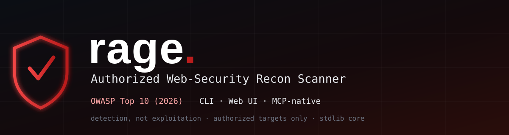
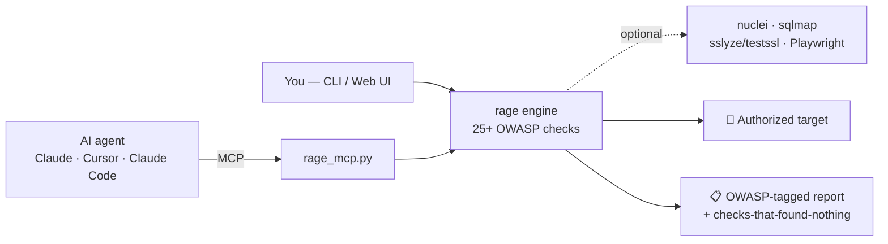

<p align="center">
  
</p>

<p align="center">
  <b>rage</b> is an authorized-only web-security recon scanner — mapped to the OWASP Top 10 (2026),
  runnable from the <b>command line</b>, a <b>local web UI</b>, or as an <b>MCP server</b> an AI agent can drive.
</p>

<p align="center">
  <a href="https://github.com/Doctor00777/Rage-MCP/actions/workflows/tests.yml"></a>
  
  
  
  
  
  
</p>

<p align="center">
  <a href="#-what-rage-does">What it does</a> ·
  <a href="#-how-it-works">How it works</a> ·
  <a href="#-three-ways-to-run-it">Run it</a> ·
  <a href="#-mcp-ai-driven">MCP</a> ·
  <a href="#-owasp-coverage">Coverage</a> ·
  <a href="#-install">Install</a> ·
  <a href="#️-responsible-use">Responsible use</a> ·
  <a href="#-honest-limits">Limits</a>
</p>

> ⚠️ **Authorized testing only.** rage is for systems you own or have explicit written permission to
> test. Every entry point requires an explicit authorization flag. Unauthorized scanning is illegal
> in most jurisdictions.

---

## 🔎 What rage does

Point rage at a web target you're allowed to test and it runs **25+ checks** across the whole OWASP
Top 10 (2026), returns findings **ranked by severity and tagged with their OWASP category**, and —
unlike most scanners — it **also lists the checks that found nothing** (clearly labelled *not proof
of absence*) and the categories that genuinely need a human.

- 🧭 **OWASP-mapped** — every finding carries its `A01`–`A10` tag.
- 🤖 **MCP-native** — an AI agent (Claude Desktop, Cursor, Claude Code) can orchestrate it as tools.
- 🧰 **Optional power tools** — plugs into `nuclei`, `sqlmap`, `sslyze`/`testssl.sh`, and a headless
  Playwright crawler when present; degrades gracefully when they're not.
- 🔐 **Authenticated scans** — cookie, bearer header, or an automatic login POST to test behind the wall.
- 🧵 **Honest by design** — detection over exploitation, heuristics labelled as such, no mass-targeting.

## 🏗 How it works



The LLM decides *what* to run; rage provides the tools and does the work — the same "AI orchestrates
the toolbox" idea as the big frameworks, scoped to **authorized, human-in-the-loop** testing.

## 🚀 Three ways to run it

```bash
# 1) CLI
py rage.py https://beta.example.com --authorized

# 2) Local web UI  → http://127.0.0.1:8787
py rage_web.py

# 3) MCP server (an AI agent drives it)
py rage_mcp.py
```

Common options:

```bash
py rage.py <target> --authorized --thorough                                  # lean on every engine
py rage.py <target> --authorized --headless --nuclei --sqlmap --time-based   # go deep (pick engines)
py rage.py <target> --authorized --cookie "session=..."                      # authenticated
py rage.py <target> --authorized -m headers tls cors sqli xss                # pick modules
py rage.py <target> --authorized --json report.json                          # machine-readable
```

## 🤖 MCP (AI-driven)

Start the server and wire it into any MCP client:

```bash
py rage_mcp.py
```

**Claude Desktop** — `claude_desktop_config.json`:

```json
{
  "mcpServers": {
    "rage": { "command": "py", "args": ["/absolute/path/to/Rage-MCP/rage_mcp.py"] }
  }
}
```

Then just ask: *“scan https://my-authorized-host with rage.”* Tools exposed:

| Tool | What it does |
|------|--------------|
| `scan` | Run an authorized scan of one target → OWASP-tagged findings + checks-that-found-nothing. Refuses unless `authorized=true`. |
| `list_modules` | The full menu of checks, which run by default, which are opt-in, and the OWASP map. |
| `tool_status` | Which optional engines are available on this host (nuclei / sqlmap / TLS engine / headless). |

## 🛡 OWASP coverage

| OWASP 2026 | Modules | What it checks |
|---|---|---|
| **A01** Broken Access Control (+SSRF) | `cors` `methods` `redirect` `ssrf` `traversal` `csrf` `auth` | CORS reflection, risky methods/TRACE, open redirect, SSRF candidates + cloud-metadata, path traversal/LFI, missing CSRF tokens, unauth sensitive paths |
| **A02** Security Misconfiguration | `headers` `misconfig` `files` `secrets` `ports` | headers, cookie flags, version leak, directory listing, verbose errors, backup/API-doc/GraphQL discovery, secrets in source, risky ports |
| **A03** Supply Chain | `fingerprint` `integrity` | tech/CMS fingerprint, EOL software, subdomain-takeover signatures, outdated JS libs |
| **A04** Cryptographic Failures | `tls` `ciphers` `mixed` `tlsaudit` | TLS version/downgrade, cert expiry, HSTS, cleartext, weak ciphers, mixed content, sensitive data in URL |
| **A05** Injection | `sqli` `xss` `ssti` `cmdi` `crlf` `injerr` `sqlmap` | SQLi, XSS, SSTI, command injection, CRLF/host-header, NoSQL/LDAP/XPath, sqlmap confirmation |
| **A06** Insecure Design | — | reported as manual-review (threat modeling / business logic) |
| **A07** Authentication Failures | `jwt` `auth` `authactive` | JWT alg=none/weak, token entropy, password-over-HTTP, login rate-limit & enumeration (opt-in) |
| **A08** Data Integrity | `integrity` | missing Subresource Integrity |
| **A09** Logging & Alerting | — | reported as manual-review (needs backend/SIEM) |
| **A10** Exceptional Conditions | `misconfig` | verbose error / stack-trace disclosure |
| — | `nuclei` | run the nuclei template engine and fold results in |

Heavy/intrusive modules (`sqlmap`, `nuclei`, `tlsaudit`, time-based & active-auth probes) are **opt-in**.

### Engines do the hard detection

rage keeps its own built-in modules to cheap, stable checks and defers the noisy,
easy-to-get-wrong detection to purpose-built engines maintained elsewhere:

| Dimension | Authoritative engine | rage's built-in role |
|---|---|---|
| SQL injection | `sqlmap` | quick error/boolean heuristic → confirm with `--sqlmap` |
| Known CVEs / templates | `nuclei` | — (enable with `--nuclei`) |
| TLS protocols & ciphers | `sslyze` / `testssl.sh` | limited probe, **superseded** when `--tls-audit` runs |

`--thorough` turns all of these on at once (plus a headless crawl and OpenAPI
fuzzing). When the TLS engine is active, the built-in `ciphers` heuristic steps
aside (it is capped by the scanner's own OpenSSL) and the report says so — fewer
hand-rolled heuristics means less to keep tuned.

## 📦 Install

The core scanner is stdlib-only (Python 3.9+). Install from PyPI — `pipx` is
recommended so the `rage`, `rage-web`, and `rage-mcp` commands land on your PATH in
an isolated environment:

```bash
pipx install rage-mcp          # or: pip install rage-mcp
rage --version
rage https://beta.example.com --authorized
```

Optional engines are pulled in via extras (install only what you need):

```bash
pip install "rage-mcp[mcp]"        # MCP server
pip install "rage-mcp[headless]"   # headless Chromium crawl, then: playwright install chromium
pip install "rage-mcp[tls]"        # trustworthy TLS audit (sslyze)
pip install "rage-mcp[all]"        # everything above
```

External binaries (optional, must be on PATH): **nuclei · sqlmap · testssl.sh**.

<details><summary>From source</summary>

```bash
git clone https://github.com/Doctor00777/Rage-MCP.git
cd Rage-MCP
pip install -e ".[all]"        # or -e . for the stdlib core only
python -m unittest discover -s tests   # run the test suite
```
</details>

## ⚖️ Responsible use

rage can send active, intrusive traffic (injection probes, sqlmap, nuclei). Use it **only** on:

- systems you own, or
- a target you have **explicit written authorization** to test (engagement/scope, bug-bounty program).

The `--authorized` flag / `authorized=true` is your attestation — it is **not** permission. rage keeps
to **single-target, detection-first, human-in-the-loop** testing: it proves a bug exists, it doesn't
exploit it, brute-force credentials, or mass-target.

## 🔭 Honest limits

- A clean report is **not proof of security** — it's a strong first pass. Real assurance needs a manual
  pentest plus source/SCA review.
- Findings labelled *likely* / *candidate* are heuristics — **confirm them manually**.
- The full external-tool power (and `sslyze`/`testssl.sh`) is Linux-first; run under **WSL/Linux** for
  best coverage.
- Categories A06/A09 and IDOR/BOLA/privilege-escalation need authenticated, multi-account, human testing.

## 🤝 Contributing

Issues and PRs welcome — new checks, better engine integrations, and false-positive fixes especially.
Keep the core dependency-free where possible, tag findings with their OWASP ID, and never weaken the
authorization gate.

## 📄 License

MIT — see [LICENSE](LICENSE).
